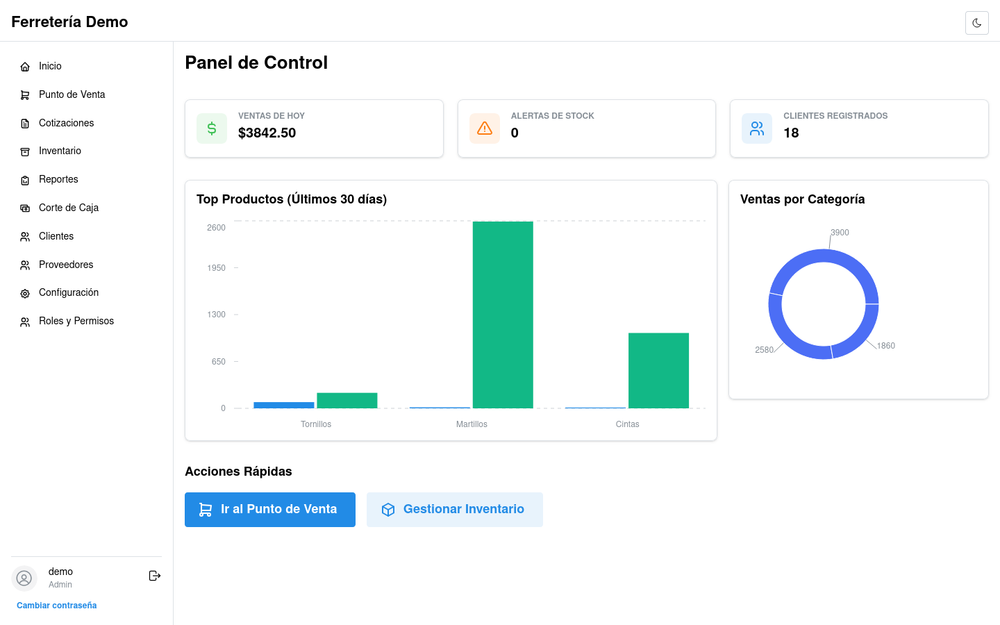
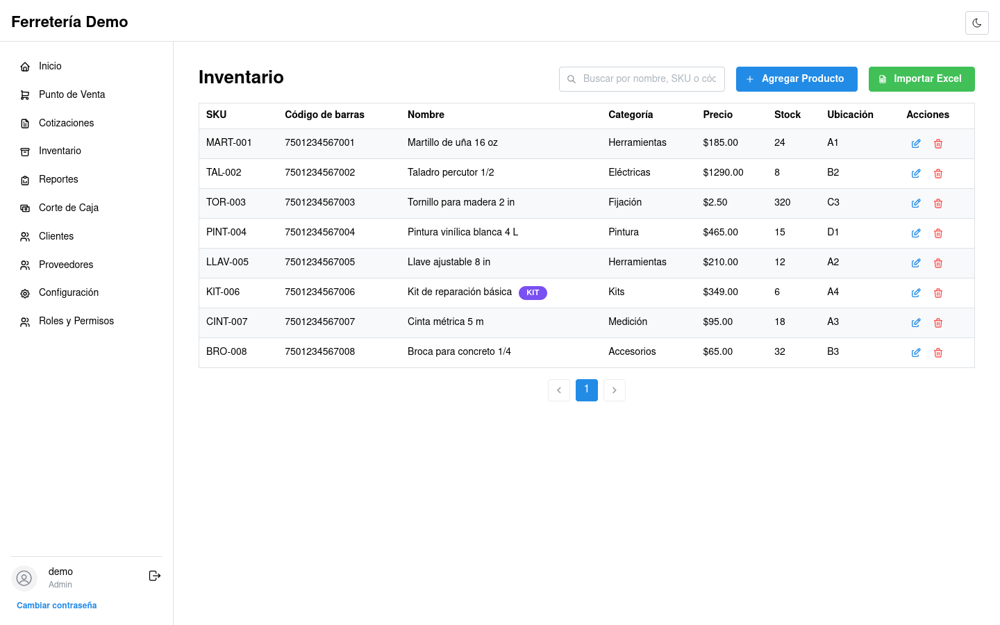
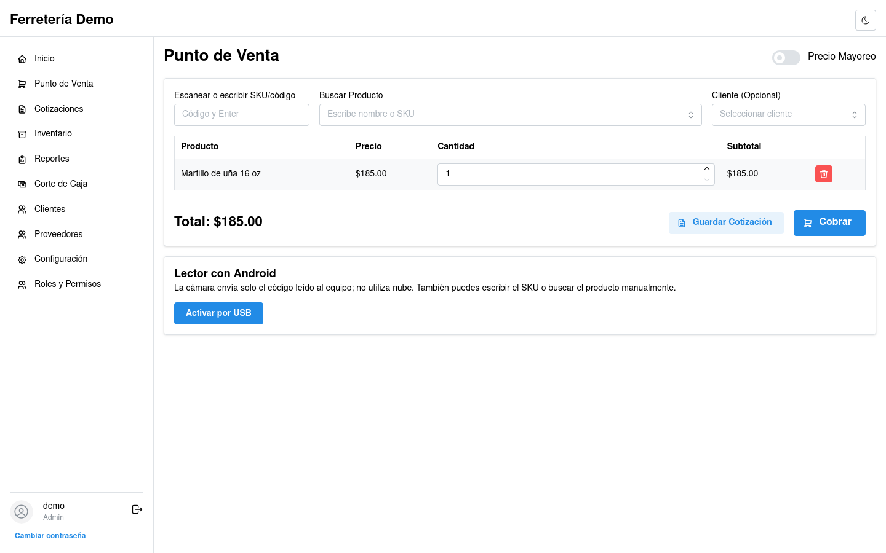

# Ferretería App

Aplicación de escritorio para gestionar inventario y ventas de una ferretería. Está desarrollada con Tauri 2, React, TypeScript y Rust. Los datos se guardan en una base SQLite local; el cifrado con SQLCipher es opcional.

**Estado:** versión 0.1.0 en fase beta. El desarrollo y las pruebas se han realizado en Fedora x86_64. Antes de usarla como único sistema de caja, conviene probar los respaldos y la impresión con el equipo del negocio.

## Funciones

- Productos, kits, stock, códigos de barras Code 128 e importación CSV/XLSX.
- Ventas en efectivo, tarjeta o pago mixto; devoluciones, cotizaciones y cortes de caja.
- Clientes, proveedores, reportes XLSX y datos del negocio para tickets.
- Usuarios, permisos por rol, bitácora y respaldos locales manuales o automáticos.
- Lector de códigos con teclado o cámara de Android conectada por USB.

La aplicación no sincroniza equipos ni envía datos a una nube propia. Los cobros con tarjeta se realizan en una terminal externa y se registran manualmente. La impresión utiliza el diálogo del sistema; no se ha validado todavía con una impresora de tickets física.

## Capturas

Interfaz con datos ficticios de demostración. Haz clic en una imagen para verla completa.

| Panel principal | Inventario | Punto de venta |
| --- | --- | --- |
| [](docs/capturas/panel.png) | [](docs/capturas/inventario.png) | [](docs/capturas/punto-de-venta.png) |

## Empezar

Consulta la [guía de instalación](docs/instalacion.md) para preparar Fedora o compilar desde el código fuente. Después sigue [primeros pasos](docs/primeros-pasos.md) para crear la base, la cuenta administradora, un producto y un respaldo.

```bash
npm ci
npm run tauri dev
```

## Documentación

- [Guía de operación](docs/operacion.md): funciones, permisos, importación, periféricos y respaldos.
- [Arquitectura](docs/arquitectura.md): componentes, datos locales y límites de integración.

Los archivos de `tests/fixtures/` incluyen plantillas ficticias y un catálogo CC0 usado como muestra; su procedencia está documentada allí. No publiques bases de datos, respaldos ni datos de clientes.

## Licencia

Copyright © 2026 Jorge Burgos. El código se distribuye bajo [GPL-3.0-only](LICENSE).
