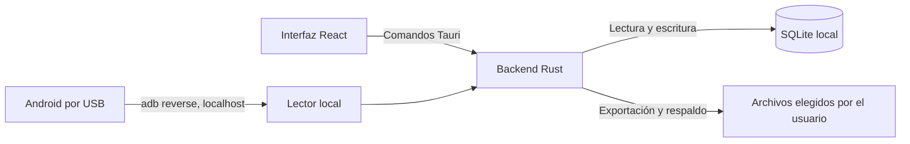

# Arquitectura y datos locales

Ferretería App es una aplicación de escritorio de un solo equipo. React y TypeScript muestran la interfaz dentro de Tauri 2; los comandos Rust realizan las operaciones del negocio, validan permisos y escriben en SQLite. No hay servidor de aplicación ni sincronización entre equipos.

## Acceso y permisos

En la primera apertura se crea la base en modo cifrado o sin cifrar y después una cuenta administradora. El cifrado opcional usa SQLCipher; la contraseña maestra abre la base y permanece en la sesión del proceso, sin guardarse como contraseña recuperable. Las contraseñas de las cuentas se guardan como hashes Argon2.

La interfaz oculta las pantallas sin permiso. En el backend, `src-tauri/src/auth.rs` comprueba la sesión, el estado actual de la cuenta y el permiso del comando. La configuración de los plugins de Tauri está en `src-tauri/capabilities/default.json`. El diálogo del sistema elige rutas; la lectura de CSV/XLSX y la escritura de reportes se hacen en comandos Rust que validan tipo, tamaño y permisos.

## Base, transacciones y respaldos

`src-tauri/src/db.rs` define el esquema y sus migraciones mediante `PRAGMA user_version`. Las ventas y devoluciones guardan efectivo y tarjeta por separado. Una venta de kit conserva la instantánea de sus componentes para que una devolución pueda reponerlos. Las importaciones se previsualizan en la interfaz y se validan de nuevo en Rust antes de escribir dentro de una transacción.

Los respaldos son archivos SQLite locales. Si la base está cifrada, los respaldos nuevos y la copia previa a una restauración usan su misma contraseña maestra; solo se restauran copias compatibles con el modo y la clave actuales. La aplicación verifica las copias antes de conservarlas. El respaldo automático, si se activa, se comprueba al abrir la base y cada hora mientras la aplicación siga abierta; genera como máximo uno al día y rota únicamente sus propios archivos. La depuración opcional de la bitácora ocurre después de una copia válida.

La restauración valida el archivo, crea una copia de la base anterior, registra la operación y cierra la sesión. Las exportaciones XLSX y los respaldos anteriores a la activación del cifrado siguen sin cifrar.

## Dispositivos y límites de integración

Un lector de códigos que emite teclas puede enviar un SKU o código de barras seguido de Enter. El lector Android usa `adb reverse` y un servidor limitado a `127.0.0.1:33737`; no abre un puerto a la red local. El teléfono procesa la imagen de la cámara y envía solo el identificador leído. Su credencial de emparejamiento es aleatoria; SQLite guarda únicamente su hash SHA-256 asociado al usuario. El registro puede revocarse.

Los tickets usan el diálogo de impresión del sistema. Los cobros con tarjeta ocurren fuera de la aplicación; se guarda el importe declarado por el operador, sin conexión a una terminal ni almacenamiento de números de tarjeta. La aplicación no envía datos del negocio a una nube propia.
